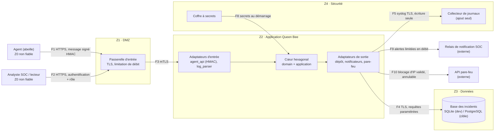

# C4 — Niveau 2 : conteneurs et frontières de confiance

Frontières : Z0 → Z1 (tout est hostile), Z1 → Z2 (mTLS), Z2 → Z3 (compte à droits minimaux),
Z2 → Z4 (écriture seule), Z2 → externe (sortie filtrée). Détail des flux : `docs/infra/flux.md`.
