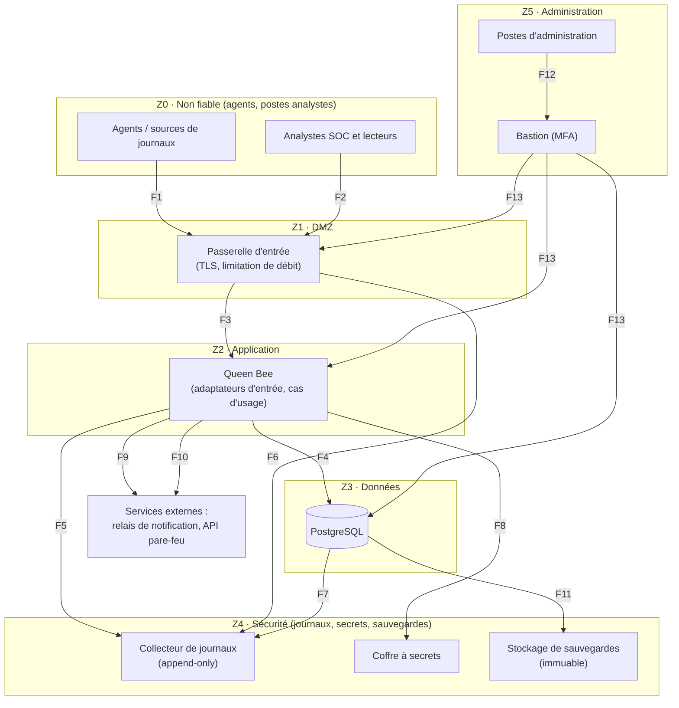

# A2 — Infrastructure cible : zones de confiance

Une zone = un niveau de confiance. On ne passe d'une zone à l'autre que par un flux déclaré
dans `flux.md` ; tout le reste est refusé.

| Zone | Contenu | Niveau de confiance | Règle d'or |
| --- | --- | --- | --- |
| Z0 | agents, postes des utilisateurs | nul : tout est hostile | on ne fait confiance à rien de ce qui en vient (signature + validation) |
| Z1 | passerelle d'entrée | faible | termine le TLS, limite le débit, ne contient aucune donnée |
| Z2 | application Queen Bee | moyen | n'accepte que la passerelle et le bastion |
| Z3 | base de données | élevé | n'accepte que l'application (+ bastion pour l'administration) |
| Z4 | journaux, secrets, sauvegardes | très élevé | l'application y écrit mais ne peut ni relire ni effacer |
| Z5 | bastion, postes admin | très élevé | seul chemin d'administration, authentification forte |
