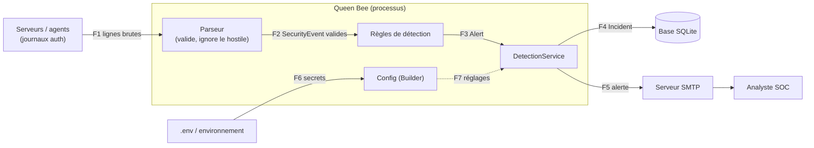

# Modèle de menaces — Queen Bee (J1 · A1)

> Périmètre : détection d'intrusion sur journaux d'authentification. Un agent/serveur produit des
> journaux ; Queen Bee les lit, applique des règles, enregistre des incidents et alerte le SOC.
> Propriétés DICP : **D**isponibilité · **I**ntégrité · **C**onfidentialité · **P**reuve (traçabilité).

## 1. Actifs

| # | Actif | Pourquoi il compte | DICP |
|---|-------|--------------------|------|
| A1 | Journaux d'authentification (entrée) | Source unique de vérité de la détection ; s'ils sont faux, tout est faux. Contiennent noms d'utilisateurs et IP. | I, P, C |
| A2 | Base des incidents (SQLite) | Historique que le SOC consulte et peut produire en justice ; la perdre ou la falsifier aveugle l'équipe. | I, D, P |
| A3 | Clé secrète applicative (`.env`) | Sa fuite permet de se faire passer pour l'application ; un secret commité est un secret compromis. | C |
| A4 | Identifiants SMTP | Permettent d'envoyer de fausses alertes (ou d'en taire de vraies) au nom de Queen Bee. | C, I |
| A5 | Configuration des règles (seuils, types) | Un seuil à 100 000 ou un type de règle injecté désactive ou détourne la détection. | I, D |
| A6 | Canal d'alerte SOC (courriel) | Si l'alerte n'arrive pas, la détection ne sert à rien. | D, I |
| A7 | Capacité de calcul du service | Un journal piégé qui sature mémoire/CPU met Queen Bee hors service au pire moment. | D |

## 2. Acteurs

| Acteur | Légitime ? | Capacité / motivation |
|--------|-----------|-----------------------|
| Analyste SOC | Oui | Lit et qualifie les incidents (OPEN → TRIAGED → [CONTAINED] → CLOSED). |
| Administrateur / opérateur | Oui | Déploie, configure `.env`, lance Queen Bee. |
| Attaquant externe | Non | Fabrique des lignes de journal (nom d'utilisateur, IP) pour injecter ou noyer la détection. |
| Insider malveillant | Non | A un accès à la base ou au dépôt ; veut effacer ses traces ou voler un secret. |
| **Agent / serveur compromis** | Semble légitime | Source de journaux de confiance qui ment : fausses IP, journaux volumineux, horodatages falsifiés. |
| Serveur SMTP usurpé | Non | Se place en face pour intercepter les alertes et les identifiants. |

## 3. Diagramme de flux de données (DFD)

Frontières de confiance :

* **TB1 — Journaux → Queen Bee (F1).** Tout ce qui franchit TB1 est contrôlé par un attaquant
  potentiel : une ligne de journal contient du texte que l'attaquant a choisi (nom d'utilisateur,
  IP source). Justification : c'est exactement le chemin de l'injection SQL du script hérité.
* **TB2 — Queen Bee → base de données (F4).** Le stockage est un autre composant avec son propre
  langage (SQL) et ses propres droits ; une donnée mal transmise devient une instruction.
* **TB3 — Queen Bee ↔ extérieur de configuration et d'alerte (F5, F6).** Les secrets entrent
  par F6 (environnement/disque) et sortent par F5 (réseau vers SMTP) : deux points où un secret
  peut fuiter ou être intercepté.

## 4. STRIDE sur les flux qui traversent une frontière

| Flux | Lettre | Menace crédible | Réponse (exigence) |
|------|--------|-----------------|--------------------|
| F1 / TB1 | **S**poofing | Un agent compromis ou un attaquant forge des lignes avec l'IP d'une victime pour la faire bloquer / alerter. | Valider chaque champ à la frontière ; l'IP doit être une IP valide (EX-01). Limite : l'authenticité de la source relève de J2/J3 (signature des journaux). |
| F1 / TB1 | **T**ampering | Nom d'utilisateur `root'; DROP TABLE x;--` : injection dans la suite du traitement. | Allowlist de caractères et de longueur, actions hors liste refusées (EX-01). |
| F1 / TB1 | **D**enial of service | Ligne de plusieurs Mo, journal sans fin : mémoire saturée. | Longueur de ligne et nombre de lignes bornés (EX-05 pour les seuils ; tests du parseur). |
| F2→F3 / interne | **R**epudiation | Événement sans fuseau horaire : impossible de dire quand, donc de prouver. | Horodatage UTC avec fuseau obligatoire (EX-02). |
| F4 / TB2 | **T**ampering | Concaténer l'IP ou le message dans le SQL permet de modifier ou détruire la base. | Requêtes paramétrées uniquement (EX-08). |
| F4 / TB2 | **R**epudiation | Un incident passe de OPEN à CLOSED sans qualification : personne n'a rien vu. | Machine à états : pas de CLOSED sans TRIAGED (EX-06). |
| F4 / F2 | **T**ampering | Un événement modifié après validation contourne les contrôles. | Objets du domaine immuables (EX-03). |
| F6 / TB3 | **I**nformation disclosure | `print(settings)`, un log ou une trace affiche la clé ou le mot de passe SMTP. | Type `Secret` masqué partout ; aucun secret dans le dépôt (EX-07). |
| F5 / TB3 | **I**nformation disclosure | Identifiants SMTP ou contenu des alertes lus sur le réseau ; serveur usurpé (**S**). | STARTTLS avant le login ; secret révélé uniquement au moment du `login` (EX-07). |
| F6 / TB3 | **E**levation of privilege | Une config contenant `__import__('os')...` fait exécuter du code arbitraire si on instancie dynamiquement le nom de règle. | Fabrique à liste blanche, aucun `getattr`/`importlib` sur une chaîne externe (EX-04). |
| F6 / TB3 | **D**enial of service | Seuil `True` (= 1) : une alerte par événement, le SOC est noyé ; seuil énorme : plus aucune alerte. | Seuil entier, hors booléen, borné 1..100 000 (EX-05). |

Couverture : S, T, R, I, D, E toutes présentes au moins une fois.

## 5. Exigences de sécurité

Format : *quoi* **DOIT** *critère mesurable*. Chaque exigence pointe vers le test qui la prouve.

**EX-01** — Un `SecurityEvent` DOIT être refusé (`DomainError`) si l'IP n'est pas une adresse valide, si le nom d'utilisateur sort de `[A-Za-z0-9_.-]{1,64}`, ou si l'action n'est pas dans la liste autorisée.
Menace : T/S sur TB1 · Propriété : I
Preuve : `tests/test_domain.py::test_invalid_event_cannot_exist` (+ `tests/test_log_parser.py::test_parser_rejects_hostile_or_malformed_lines`)

**EX-02** — Un `SecurityEvent` DOIT être refusé si son horodatage n'a pas de fuseau horaire.
Menace : R sur le flux F2 · Propriété : P
Preuve : `tests/test_domain.py::test_naive_timestamp_rejected`

**EX-03** — Un `SecurityEvent` DOIT lever `FrozenInstanceError` à toute tentative de modification après construction.
Menace : T sur F2 · Propriété : I
Preuve : `tests/test_domain.py::test_event_is_immutable`

**EX-04** — La fabrique de règles DOIT lever `DomainError` pour tout nom de règle absent de la liste blanche, y compris `__import__('os')`, et pour toute clé de configuration inattendue.
Menace : E sur TB3 · Propriété : I
Preuve : `tests/test_domain.py::test_factory_rejects_unknown_rule` (+ `tests/test_abuse.py::test_abuse_malformed_rule_spec_is_rejected`)

**EX-05** — Un seuil de règle DOIT être un entier non booléen compris entre 1 et 100 000, à la création comme à la copie (Prototype).
Menace : D sur TB3 · Propriété : D
Preuve : `tests/test_domain.py::test_factory_rejects_bool_threshold`, `tests/test_creational.py::test_prototype_copy_is_revalidated`, `tests/test_abuse.py::test_abuse_invalid_threshold_is_rejected`

**EX-06** — Un incident DOIT passer par TRIAGED avant CLOSED ; toute autre transition DOIT lever `DomainError`.
Menace : R sur TB2 · Propriété : P
Preuve : `tests/test_domain.py::test_state_forbids_skipping_triage`

**EX-07** — Aucun secret (clé applicative, mot de passe SMTP) NE DOIT apparaître dans `repr`, `str` ou les messages d'erreur d'un objet de configuration ; les secrets DOIVENT provenir de l'environnement, jamais du code.
Menace : I sur TB3 · Propriété : C
Preuve : `tests/test_config.py::test_secret_never_appears_in_repr_or_str`, `tests/test_config.py::test_key_is_read_from_environment_not_from_code`, `tests/test_abuse.py::test_abuse_builder_rejects_short_secret_without_leaking_it`

**EX-08** — Le dépôt SQLite DOIT stocker une donnée hostile (`x'); DROP TABLE incidents;--`) comme simple texte, sans modifier le schéma ni perdre d'autres lignes.
Menace : T sur TB2 · Propriété : I
Preuve : `tests/test_repositories.py::test_sql_injection_is_stored_as_data_not_executed`

## 6. Mise à jour du jour 2 : nouveaux flux (architecture hexagonale)

L'architecture hexagonale (ADR 0001) ajoute des flux et des frontières : messages signés des agents,
utilisateurs avec rôles, pare-feu. Les frontières sont reprises dans le C4 de contexte
(`docs/c4/context.md`) et le parcours (`docs/parcours.md`).

| ID | Nouveau flux | Menace (STRIDE) | Parade | Preuve |
| --- | --- | --- | --- | --- |
| M-J2-01 | Agent → `parse_agent_message` | S : signature forgée | HMAC-SHA256 + `hmac.compare_digest` | `tests/test_adapters.py::test_abuse_forged_signature_rejected` |
| M-J2-02 | Agent → `parse_agent_message` | T : champ modifié après signature | signature sur le corps exact du message | `tests/test_inbound_malicious.py::test_tampered_field_after_signing_rejected` |
| M-J2-03 | Agent → `parse_agent_message` | T : champ en trop (mass assignment) | schéma strict, ensemble de clés exact | `tests/test_adapters.py::test_abuse_extra_field_rejected` |
| M-J2-04 | Agent → `parse_agent_message` | D : message énorme | borne de 4 Kio avant tout calcul de signature ou parsing | `tests/test_inbound_malicious.py::test_oversized_message_rejected_before_signature_check` |
| M-J2-05 | Journal → `parse_sshd_line` | T/D : ligne piégée ou géante | longueur bornée, regex ancrée `fullmatch`, rejet compté par la façade `QueenBee` | `tests/test_adapters.py::test_malicious_lines_rejected`, `tests/test_adapters.py::test_parser_is_fast_on_adversarial_input` |
| M-J2-06 | Application → notificateurs | D : inondation d'alertes | `RateLimitedNotifier` (fenêtre, horloge injectée), rejets comptés | `tests/test_services.py::test_abuse_rate_limiter_absorbs_alert_flood` |
| M-J2-07 | Utilisateur → `IncidentService` / Proxy | E : lecteur qui modifie | rôle exigé avant tout accès au dépôt | `tests/test_hexagon.py::test_reader_cannot_modify_through_proxy`, `tests/test_services.py::test_abuse_viewer_cannot_close_incident` |
| M-J2-08 | Utilisateur → `IncidentReadProxy` | I : lecture sans rôle | Procuration, refus compté | `tests/test_services.py::test_proxy_blocks_principal_without_role`, `tests/test_hexagon.py::test_denied_reads_are_counted` |
| M-J2-09 | Application → sqlite | T : injection SQL | requêtes paramétrées | `tests/test_services.py::test_sqlite_repo_resists_injection` |
| M-J2-10 | Application → pare-feu | T : commande piégée | IP validée avant exécution, annulation (Commande) | `tests/test_services.py::test_command_undo` |
| M-J2-11 | Notificateur en panne | D : un abonné bloque les autres | `FanOutNotifier` isole et compte les pannes (Observateur) | `tests/test_hexagon.py::test_observer_failure_does_not_block_other_subscribers` |
| M-J2-12 | Application → notificateurs | R : alerte envoyée sans trace | `AuditedNotifier` journalise chaque alerte | `tests/test_services.py::test_audit_decorator_logs` |
| M-J2-13 | Flux de menaces externe → application | T : indicateur non vérifiable | couche anti-corruption `ThreatFeedTranslator` | `tests/test_inbound_malicious.py::test_threat_feed_rejects_unknown_risk_level` |

Test par propriétés (Hypothesis) : `tests/test_inbound_malicious.py::test_hypothesis_signed_garbage_fields_are_rejected_or_valid`,
`tests/test_adapters.py::test_parser_never_crashes_unexpectedly`.

## 7. Mise à jour du jour 3 : failles de la variante de laboratoire

Exploitation uniquement sur `labs/vulnerable_queenbee.py`, en local. Détail : `docs/revue_securite.md`.

| ID | Faille | Couche | STRIDE | DICP | Correctif | Preuve puis non-régression |
| --- | --- | --- | --- | --- | --- | --- |
| M-J3-01 | Secret en dur partagé | configuration | I | C | ADR 0010 | `tests/test_lab_vulnerable.py::test_faille1_no_secret_in_code_and_refuses_to_start_without_key` |
| M-J3-02 | Regex à retour arrière exponentiel (ReDoS) | adaptateur | D | D | ADR 0011 | `tests/test_lab_vulnerable.py::test_faille2_redos_is_gone` |
| M-J3-03 | Désérialisation pickle | adaptateur | T, E | I | ADR 0012 | `tests/test_lab_vulnerable.py::test_faille3_pickle_payload_is_refused_without_running_code` |
| M-J3-04 | Requête SQL construite par f-string | persistance | T | I | ADR 0013 | `tests/test_lab_vulnerable.py::test_faille4_sql_injection_no_longer_dumps_table` |
| M-J3-05 | Aucune autorisation dans le service | application | E | C, I | ADR 0014 | `tests/test_lab_vulnerable.py::test_faille5_without_analyst_role_cannot_close` |
| M-J3-06 | Services qui ne s'authentifient pas | infrastructure | S | I, P | ADR 0015 | `tests/test_lab_vulnerable.py::test_faille6_unauthenticated_calls_refused_and_counted` |
| M-J3-07 | Comparaison de jeton non constante | sécurité | I | C | ADR 0016 | `tests/test_lab_vulnerable.py::test_faille7_token_comparison_is_constant_time` |

Les flux de l'infrastructure cible (F1 à F13) et leurs menaces sont dans `docs/infra/flux.md`.
Traçabilité complète : `docs/tracabilite.md`.

## 8. Limites connues et risques résiduels (honnêteté du modèle)

* **Rejeu** d'un message signé valide : pas de nonce ni de fenêtre de temps sur l'horodatage (S/R sur
  le flux agent). Risque accepté, inscrit dans la dette (`docs/release.md`).
* **Agent compromis** qui possède la clé : la signature prouve que le message vient d'un détenteur de la
  clé, pas qu'il dit vrai. Clé unique partagée entre agents : une fuite compromet tous les agents.
* La base SQLite n'est pas chiffrée ni protégée contre un insider qui a accès au fichier (menace T/I
  sur A2 hors du processus) : traité dans l'infrastructure cible (zone Z3, ADR 0006), pas encore déployé.
* Le limiteur de débit est en mémoire : son état est perdu au redémarrage (voir ADR 0001).
