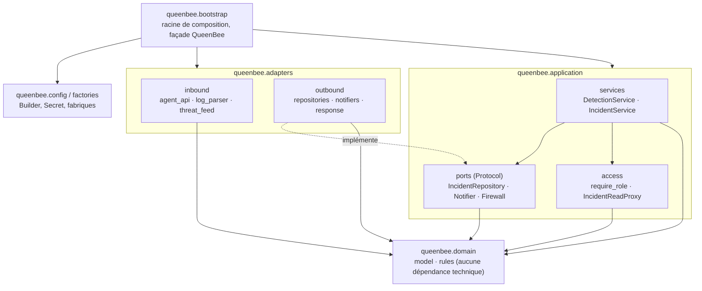

# Diagramme de composants — les dépendances pointent vers le centre

Le sens des flèches est vérifié par `lint-imports` (contrat de couches dans `pyproject.toml`).

Diagrammes associés : classes (`docs/uml/patterns.md`), séquence d'ingestion (`docs/uml/sequence_ingest.puml`),
C4 niveaux 1 et 2 (`docs/c4/`).
